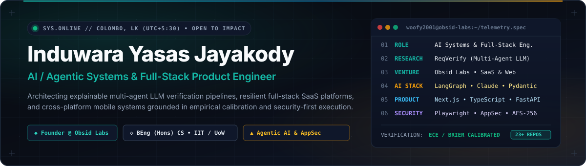
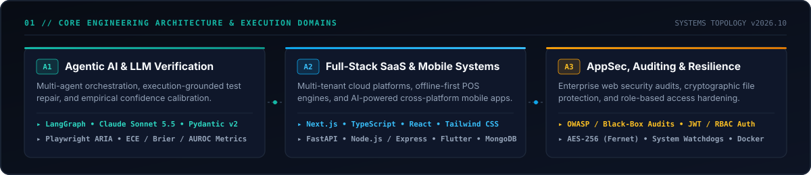
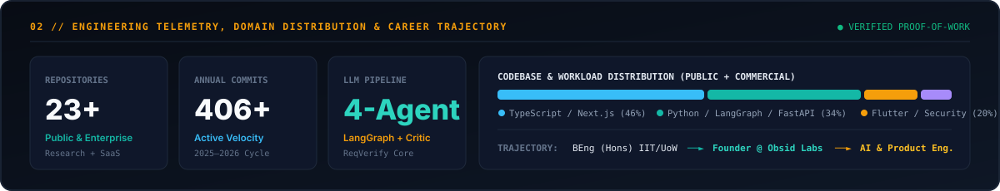

<div align="center">

<picture>
  <source media="(prefers-color-scheme: dark)" srcset="./assets/hero-banner.svg" />
  <source media="(prefers-color-scheme: light)" srcset="./assets/hero-banner.svg" />
  
</picture>

<br/>

[](https://www.linkedin.com/in/induwara-jayakody-21a478303)
[](mailto:zed.induwara@gmail.com)
[](https://github.com/Woofy2001)
[-0F172A?style=for-the-badge&logo=anthropic&logoColor=2DD4BF&labelColor=0A0E17)](https://github.com/Woofy2001/reqverify)

</div>

---

### `00 // EXECUTIVE POSITIONING`

I am an **AI / Agentic Systems & Full-Stack Product Engineer** based in **Colombo, Sri Lanka**, and the **Founder & Lead Engineer at Obsid Labs**. Currently completing my **BEng (Hons) in Computer Science / Software Engineering** at the **Informatics Institute of Technology (IIT) in collaboration with the University of Westminster (UK)**, I specialize in bridging **multi-agent LLM orchestration** with **production-grade full-stack web, mobile, and security architectures**.

| Dimension | Current Focus & Proof of Work |
| :--- | :--- |
| **🔬 Agentic AI Research** | Architecting **[ReqVerify](https://github.com/Woofy2001/reqverify)** — a 4-agent explainable requirements-verification framework using **Claude Sonnet 5.5**, **LangGraph**, **Pydantic v2**, and **Playwright** with empirical confidence calibration (**ECE, Brier Score, AUROC**). |
| **🏢 Venture & SaaS Engineering** | Leading product architecture at **Obsid Labs** — shipping multi-tenant SaaS POS platforms (offline-first sync, CRM, analytics) and high-craft commercial web systems using **Next.js, TypeScript, and Node.js**. |
| **📱 Cross-Platform & Generative Products** | Building AI-assisted mobile workflows (**[ProjectBluePrint](https://github.com/Woofy2001/ProjectBluePrint)**) combining **Flutter** frontends with **FastAPI** generative rendering backends and real-time **Firebase** synchronization. |
| **🛡️ AppSec & System Resilience** | Executing enterprise black-box security audits, role-based access control (**JWT/RBAC**) hardening, and cryptographic endpoint utilities (**[SecureVault](https://github.com/Woofy2001/SecureVault)** with **AES-256 / Fernet**). |

<br/>

<div align="center">
  
</div>

---

### `01 // FLAGSHIP OPEN-SOURCE & RESEARCH SYSTEMS`

<table>
  <tr>
    <td width="50%" valign="top">
      <h4>🔬 <a href="https://github.com/Woofy2001/reqverify">ReqVerify</a> — <code>Multi-Agent LLM Verification</code></h4>
      <p>
        <b>Black-box web requirements verification framework</b> that transforms plain-English software specifications into an auditable, requirement-by-requirement verification matrix.
      </p>
      <ul>
        <li><b>4-Agent LangGraph Pipeline:</b> Requirements Analyst → ARIA App Explorer → Playwright Generator &amp; Execution-Grounded Critic (≤3 repair loops) → Calibrated Verdict Engine.</li>
        <li><b>Empirical Calibration:</b> Evaluates confidence calibration via Expected Calibration Error (ECE), Brier Score, and AUROC rather than unverified LLM self-reporting.</li>
      </ul>
      <p>
        
        
        
        
        
      </p>
    </td>
    <td width="50%" valign="top">
      <h4>🏗️ <a href="https://github.com/Woofy2001/ProjectBluePrint">ProjectBluePrint</a> — <code>AI Floor Plan Studio</code></h4>
      <p>
        <b>AI-powered architectural floor plan generator and marketplace</b> enabling voice-to-plan and prompt-to-plan 2D layout synthesis in seconds.
      </p>
      <ul>
        <li><b>Generative FastAPI Backend:</b> Processes natural-language and voice spatial constraints into rendered 2D layouts using Python, NumPy, Matplotlib, and Pillow.</li>
        <li><b>Real-Time Mobile Client:</b> Cross-platform <b>Flutter</b> application with Provider state management, Firebase Auth, Cloud Firestore sync, and professional marketplace.</li>
      </ul>
      <p>
        
        
        
        
      </p>
    </td>
  </tr>
  <tr>
    <td width="50%" valign="top">
      <h4>🏠 <a href="https://github.com/Woofy2001/boarding-buddy-connect">Boarding Buddy Connect</a> — <code>Full-Stack Platform</code></h4>
      <p>
        <b>Student accommodation marketplace and modular REST architecture</b> connecting university students across Sri Lanka with verified housing providers.
      </p>
      <ul>
        <li><b>Role-Based Security:</b> Enforces strict JWT authentication and `bcryptjs` credential hashing across `student` and `landlord` permission boundaries.</li>
        <li><b>Scalable Media &amp; Messaging:</b> Multi-attribute property filtering, Cloudinary stream uploads via Multer, bookmarking, and 1:1 landlord-student messaging.</li>
      </ul>
      <p>
        
        
        
        
      </p>
    </td>
    <td width="50%" valign="top">
      <h4>🛡️ <a href="https://github.com/Woofy2001/SecureVault">SecureVault</a> — <code>Cryptographic Endpoint Defense</code></h4>
      <p>
        <b>Modular Python cybersecurity utility</b> engineered for local file encryption, directory integrity monitoring, and unauthorized peripheral detection.
      </p>
      <ul>
        <li><b>Symmetric Cryptography:</b> Implements authenticated AES-256 file encryption and decryption workflows powered by Python `cryptography` (Fernet).</li>
        <li><b>Host Intrusion Telemetry:</b> Integrates filesystem `watchdog` observers and `pyudev` / `pywin32` device hooks to log suspicious access patterns in real time.</li>
      </ul>
      <p>
        
        
        
        
      </p>
    </td>
  </tr>
</table>

---

### `02 // PRODUCTION SAAS & ENTERPRISE ENGINEERING (OBSID LABS & COMMERCIAL)`

Beyond open-source repositories, I architect and maintain commercial production systems across multi-tenant SaaS, enterprise security auditing, and digital commerce:

| System / Engagement | Architecture & Engineering Scope | Core Stack |
| :--- | :--- | :--- |
| **Multi-Tenant Cloud POS (`Pos_System_WC`)** | Full-scale multi-tenant SaaS Point-of-Sale system supporting retail, hospitality, pharmacies, and salons. Features **offline-first synchronization**, real-time inventory & CRM analytics, and a **Super-Admin Control Plane**. | `TypeScript` • `React / Next.js` • `PHP / REST` • `Offline Sync` |
| **Enterprise Security & AppSec Audits (`Nikko Motors`)** | Comprehensive application security auditing (`nikko-motors-security-audit`) and full-stack spare parts commerce architecture (`Nikko_Spare_Parts`) focused on access control, input sanitization, and OWASP remediation. | `TypeScript` • `AppSec Auditing` • `OWASP Top 10` • `RBAC` |
| **Obsid Labs Commercial Web Platforms** | End-to-end product design, high-conversion frontend engineering, and custom backend integrations for luxury retail (`v_jewellery`, `Sanjeewani`), construction (`wj-construction`), and investment firms (`Td_Investment`). | `Next.js` • `TypeScript` • `Tailwind CSS` • `Cloud Infra` |
| **Concurrent Ticketing Engine (`TicketBookingSystem`)** | Multi-threaded producer-consumer ticket pool engine with real-time concurrency control, priority customer queuing, and dual CLI / TypeScript web interfaces. | `Java (Multi-Threading)` • `TypeScript` • `REST API` |

<br/>

<div align="center">
  
</div>

---

### `03 // TECHNICAL ARSENAL & TOOLING`

```yaml
ai_and_agentic_systems:
  orchestration: ["LangGraph", "Multi-Agent State Machines", "Execution-Grounded Critic Loops"]
  models_and_contracts: ["Claude API (Sonnet 5.5)", "OpenAI SDK", "Pydantic v2", "Structured Outputs"]
  evaluation_and_qa: ["Playwright (ARIA / Black-Box)", "Confidence Calibration (ECE, Brier, AUROC)", "Pytest"]

full_stack_and_mobile:
  frontend: ["TypeScript", "JavaScript (ES2024+)", "Next.js (App Router)", "React", "Tailwind CSS", "HTML5/CSS3"]
  backend: ["Python (FastAPI, Flask)", "Node.js (Express.js)", "Java", "PHP", "RESTful API Design"]
  mobile: ["Flutter", "Dart", "React Native / Expo", "Provider State Management"]

data_cloud_and_security:
  databases: ["PostgreSQL", "MongoDB Atlas (Mongoose)", "Firebase Firestore", "MySQL", "SQLite"]
  security_and_crypto: ["OWASP Web Security Auditing", "JWT / RBAC Auth", "AES-256 (Fernet)", "Watchdog Telemetry"]
  devops_and_infra: ["Docker", "Git & GitHub Actions", "Linux / Bash", "Cloudinary", "Vercel"]
```

<div align="center">


</div>

---

### `04 // CAREER PATH & ARCHITECTURAL PRINCIPLES`

- **Explainable AI Over Black-Box Hype:** Every agentic workflow I build enforces typed **Pydantic v2** schemas, deterministic execution traces, and empirical calibration metrics so engineering teams can audit *why* an AI system reached a verdict.
- **End-to-End Product Ownership:** As Founder at **Obsid Labs**, I own the full lifecycle—from system topology, database schema design, and API security hardening to polished, low-latency user interfaces.
- **Security-First Engineering:** Trained in both offensive/defensive web security auditing and full-stack development, treating authentication boundaries, cryptographic storage, and automated E2E verification as first-class citizens.

---

<div align="center">
  <sub>
    <b>Induwara Yasas Jayakody</b> • Colombo, Sri Lanka • 
    <a href="https://www.linkedin.com/in/induwara-jayakody-21a478303">LinkedIn</a> • 
    <a href="mailto:zed.induwara@gmail.com">zed.induwara@gmail.com</a>
  </sub>
</div>
